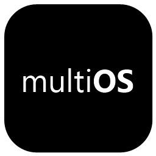

<p align="center">
  
</p>

<h1 align="center">multiOS</h1>

<p align="center"><a href="README.md">Türkçe</a> · <strong>English</strong></p>

Share photos, files and clipboard content between an iPhone and Windows over your
local network. Windows uses a native WPF window and system tray. Files travel
directly between devices; no cloud account is required.

## App preview

### Windows

<a href="assets/screenshots/windows-light.png">
  <picture>
    <source media="(prefers-color-scheme: dark)" srcset="assets/screenshots/windows-dark.png">
    <source media="(prefers-color-scheme: light)" srcset="assets/screenshots/windows-light.png">
    
  </picture>
</a>

### Phone

File transfers and clipboard sharing, shown as separate sections.

<table>
  <tr>
    <th width="50%">Files</th>
    <th width="50%">Clipboard</th>
  </tr>
  <tr>
    <td valign="top"><a href="assets/screenshots/phone-files-light.png">
  <picture>
    <source media="(prefers-color-scheme: dark)" srcset="assets/screenshots/phone-files-dark.png">
    <source media="(prefers-color-scheme: light)" srcset="assets/screenshots/phone-files-light.png">
    
  </picture>
</a></td>
    <td valign="top"><a href="assets/screenshots/phone-clipboard-light.png">
  <picture>
    <source media="(prefers-color-scheme: dark)" srcset="assets/screenshots/phone-clipboard-dark.png">
    <source media="(prefers-color-scheme: light)" srcset="assets/screenshots/phone-clipboard-light.png">
    
  </picture>
</a></td>
  </tr>
  <tr>
    <td>Send photos and download prepared files.</td>
    <td>Share text and images in both directions.</td>
  </tr>
</table>

*Actual interfaces captured with sample data. Phone screenshots use a mobile browser viewport, not a physical iPhone. Images follow your GitHub theme. Click an image to view it at full size.*

## Requirements

- Windows 10 or 11, 64-bit, with .NET Framework 4.8.
- Node.js 22 or later and npm for development; the packaged app bundles Node.js.
- iPhone and PC on the same trusted local network. Allow the app through Windows
  Firewall on private networks. Guest Wi-Fi may block communication between devices.
- HEIC previews depend on installed Windows codecs; receiving originals does not.

## Run from source

Clone the repository, open PowerShell in its folder, and run:

```powershell
npm ci
npm run build:native
npm start
```

The build compiles the desktop app, clipboard helper and thumbnail helper using
Windows' .NET Framework compiler; Visual Studio is not required.
`npm run tray` starts the native app and service. `npm run start:silent` starts
only the service. Closing the window hides it while receiving continues. Use
**Exit** from the tray to stop both. Windows startup is opt-in in Settings.

## Connect an iPhone

1. Open the **iPhone** page in multiOS and scan its QR code.
2. Open the page in Safari to send files or download staged PC files.
3. For the iOS Share Sheet, expand **Paylaş menüsü kurulumu**. First copy the
   personal upload address, then add the linked **PC'ye Gönder** shortcut. Paste
   that address into its setup question and finish adding it. This is a one-time step.

The shared shortcut asks for a personal upload address during setup. It must
include the pairing key copied from the phone page. The key persists across restarts and updates,
so repeated pairing is unnecessary. Prefer `multios.local` when it resolves on
your network; an IP-based shortcut address must be updated if the PC's IP changes.
Save the phone page to the Home Screen for convenient access.
`MULTIOS_SHORTCUT_URL` overrides the default iCloud shortcut link.

## Standalone build

```powershell
npm ci
npm run build:dist
```

Output: `dist/multiOS.exe`. The build installs only production dependencies in
a temporary staging folder and downloads the matching Node.js license from the
official Node.js repository; internet access is required. Running the package
extracts files to `%LOCALAPPDATA%/multiOS/app`, creates Desktop and Start Menu
shortcuts, and opens the native window.

For an existing local installation, `scripts/update-local.ps1` backs it up under
`%LOCALAPPDATA%/multiOS/backups`, stops it, installs the new package and verifies
that the pairing key was preserved. It refuses to update during an active transfer.

## Data and security

- Incoming files default to `Downloads/multiOS`. Settings can select any writable
  folder, including one on the Desktop. Existing files stay where they are.
- Pairing state, history, clipboard cache and outgoing staged copies live under
  `%APPDATA%/multiOS`. Treat this folder and personal pairing URLs as private.
- Clearing received history preserves originals. Clearing outgoing files deletes
  staged copies, not sources. Clearing the app clipboard preserves the Windows clipboard.
- Phone requests require the pairing key. Native desktop control is restricted to
  loopback with a local Host header. Foreign browser origins are rejected.
- Transfers use local HTTP, not encrypted HTTPS. Use a trusted private network;
  do not expose this service through port forwarding or as a public server.
- The clipboard helper observes Windows clipboard content while running. Its
  current content is available to paired devices. Exit from the tray to stop it.
  Phone clipboard images are limited to one image of at most 50 MB per request.

## Verification

```powershell
npm run build:native
npm test
npx playwright install chromium
npm run test:ui
```

Tests start isolated services and use temporary data without touching the real
clipboard, startup settings or shortcuts. API checks cover authorization,
uploads, interrupted transfers, duplicate names, persistence, cleanup and receive
folders. The phone UI test covers upload/download, controls, light/dark layouts
and overflow; screenshots go to ignored `test-results/`. To use installed Edge:

```powershell
$env:MULTIOS_BROWSER_CHANNEL = 'msedge'
npm run test:ui
```

Native `--capture <absolute-png-path> --verify` checks title text hit testing,
closing to the tray, receiving with the window hidden, navigation, staging and
clipboard display, then exits through the tray. Use isolated `MULTIOS_PORT`,
`MULTIOS_DATA_DIR`, `MULTIOS_DROP_DIR` and `MULTIOS_STAGED_DIR`, with
`MULTIOS_DISABLE_CLIPBOARD=1` and `MULTIOS_DISABLE_MDNS=1`.

Real iPhone permissions, shortcut installation, Wi-Fi changes, sleep/resume,
HEIC codecs and long videos still need device checks. Automated checks do not
cover every Windows configuration.

## Project layout

- `src/native/`: WPF app, helpers and package launcher.
- `src/`: HTTP service, pairing, storage and transfer state.
- `public/`: iPhone page and styles.
- `scripts/`: build and local installation tools.
- `tests/`: isolated API and phone UI checks.

## License

MIT; see [LICENSE](LICENSE). Apple navigation icon attribution is in
[assets/NOTICE.md](assets/NOTICE.md). Dependencies retain their licenses in the
packaged `node_modules`; the bundled Node.js license is in `runtime/LICENSE`.
