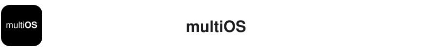
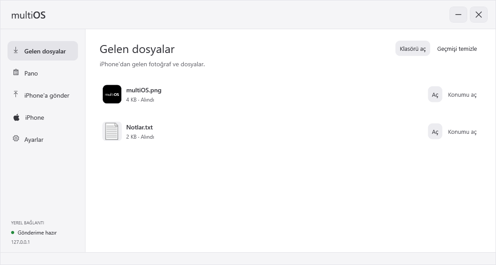
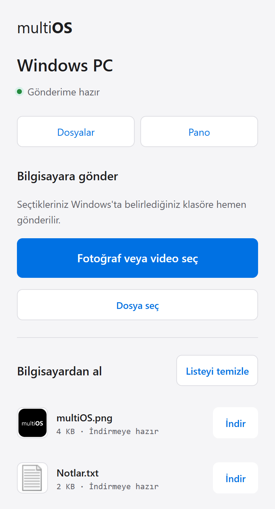
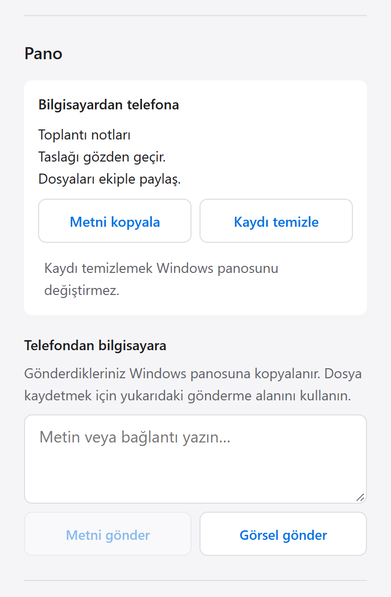

<p>
  
</p>

<p align="center"><a href="README.md">Türkçe</a> · <strong>English</strong></p>

Share photos, files and clipboard content between an iPhone and Windows over your
local network. Windows uses a native WPF window and system tray. Files travel
directly between devices; no cloud account is required.

[**Download for Windows · v0.2.0**](https://github.com/ardayesilgul/multiOS/releases/latest/download/multiOS.exe)

## Screenshots

### Windows

<a href="assets/screenshots/windows-wide-light.png">
  <picture>
    <source media="(prefers-color-scheme: dark)" srcset="assets/screenshots/windows-wide-dark.png">
    <source media="(prefers-color-scheme: light)" srcset="assets/screenshots/windows-wide-light.png">
    
  </picture>
</a>

### Phone

<table>
  <tr>
    <th width="50%">Files</th>
    <th width="50%">Clipboard</th>
  </tr>
  <tr>
    <td valign="top"><a href="assets/screenshots/phone-files-light.png">
  <picture>
    <source media="(prefers-color-scheme: dark)" srcset="assets/screenshots/phone-files-dark.png">
    <source media="(prefers-color-scheme: light)" srcset="assets/screenshots/phone-files-light.png">
    
  </picture>
</a></td>
    <td valign="top"><a href="assets/screenshots/phone-clipboard-light.png">
  <picture>
    <source media="(prefers-color-scheme: dark)" srcset="assets/screenshots/phone-clipboard-dark.png">
    <source media="(prefers-color-scheme: light)" srcset="assets/screenshots/phone-clipboard-light.png">
    
  </picture>
</a></td>
  </tr>
  <tr>
    <td>Send photos and download prepared files.</td>
    <td>Share text and images in both directions.</td>
  </tr>
</table>

## Installation

Requires Windows 10/11 (64-bit) and .NET Framework 4.8. Open the EXE to install the
app and create a Desktop shortcut. You don't need to install Node.js.

Closing the window keeps multiOS in the system tray, ready to receive files.
Choose **Exit** from the tray to quit.

## Connect an iPhone

1. Connect your phone and PC to the same Wi-Fi network.
2. Open **iPhone** in multiOS and scan the QR code.
3. Use the Safari page to send photos and files, download files from the PC,
   or share clipboard content.

For the iOS Share Sheet, open **Paylaş menüsü kurulumu** on the phone page. Copy
the personal address, add **PC'ye Gönder**, and paste the address into its setup
question. Pairing is a one-time step and survives updates.

If `multios.local` doesn't resolve, use the IP address. Update the shortcut if the
PC's IP changes. Allow multiOS through Windows Firewall on private networks.

## Files and privacy

- Received files go to `Downloads/multiOS`. Choose another folder in Settings.
- While multiOS is running, paired phones can access the Windows clipboard.
- Transfers use local HTTP. Use a trusted private network and don't expose the service to the internet.
- HEIC previews depend on Windows codecs; receiving the file doesn't.

[Storage locations and cleanup behavior](docs/data.md) (Turkish)

## Development

```powershell
npm ci
npm run build:native
npm start
```

Development requires Node.js 22 or later.
[Build and packaging](docs/development.md) · [Testing](docs/testing.md) (Turkish)

```powershell
npm test
```

## License

MIT; see [LICENSE](LICENSE). Apple navigation icon attribution is in
[assets/NOTICE.md](assets/NOTICE.md). Dependencies retain their licenses in the
packaged `node_modules`; the bundled Node.js license is in `runtime/LICENSE`.

---

**Developer:** [Arda Yeşilgül](https://github.com/ardayesilgul).
